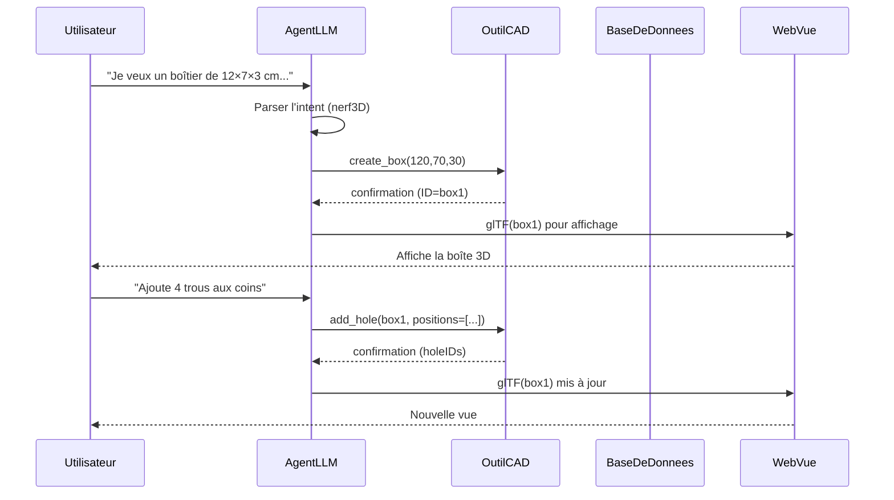
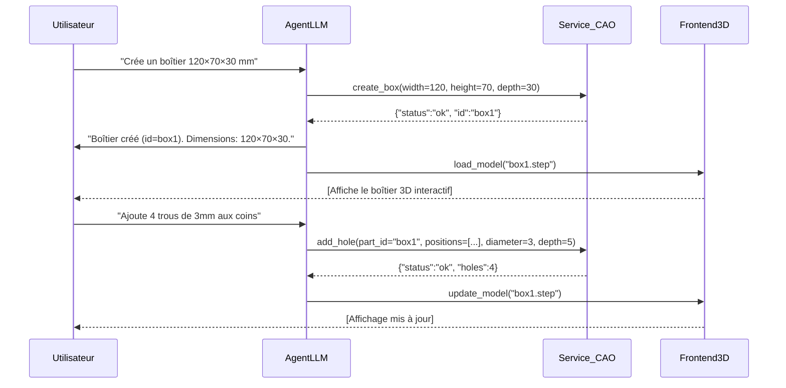

# Résumé exécutif 

L’étude conclut qu’il est réaliste de bâtir dans Aurora un **« studio d’innovation » 3D** où un LLM généraliste (GPT/Claude/minimal) orchestre une chaîne déterministe de moteurs de CAO paramétrique. Au lieu de générer directement une image 3D (très coûteux en GPU), l’IA produit **de la structure** (instructions, JSON, script Python) qu’un moteur géométrique (OpenCascade) exécute pour obtenir un solide précis. Cette approche est en phase avec les outils CAD-as-code actuels (CadQuery, build123d, FreeCAD, etc.). Le LLM interprète les intentions de l’utilisateur (“agrandis le boîtier de 5 mm”), planifie les opérations (ex : ajuster la largeur du boîtier sans déplacer les ports), et appelle des fonctions codées. Le moteur géométrique calcule alors le nouveau modèle, exportable en STEP, STL, 3MF, etc.  

Nous recommandons une architecture où l’**agent LLM** agit comme « cerveau » sémantique, relayant à un **service de CAO paramétrique** les commandes structurées (via Function-Calling/JSON). Un front-end WebGL (Three.js ou Babylon.js) affiche et permet d’interagir avec la maquette 3D (glTF). Cette séparation LLM (sémantique) / moteur géométrique (calcul) garantit la précision et la réutilisabilité des modèles, tout en restant ouvert (formats standards, code textuel). 

Les prochaines étapes concrètes sont : 1) prototyper un mini-pipeline « IA → engine paramétrique → viewer » sur un cas simple (création d’un boîtier avec composant) ; 2) valider l’édition interactive (undo, history, contraintes de fabrication) ; 3) étendre à l’échelle du « kit de marque ». Nous proposons aussi un tableau comparatif des outils candidats (cadquery, build123d, OpenCascade, FreeCAD, Blender+Sverchok, Three.js, Babylon.js, glTF), leur licence et statut. Enfin, un plan de prototype et des schémas de séquence/microservices illustrent l’architecture. 

# Technologies et cadres paramétriques 

La base du système repose sur des bibliothèques CAD **scriptables** en Python/JavaScript : 

- **CadQuery** (Apache 2.0) est une librairie Python pour modéliser en 3D par script. Elle s’appuie sur OpenCASCADE (OCCT) et permet de créer des solides paramétriques (boîtes, trous, filets, lofts, assemblages). CadQuery **exporte** directement vers les formats CAO (STEP, 3MF, etc.) ou impression 3D (STL). Ses scripts sont du texte clair, même exécutables dans un navigateur. C’est un outil mature, actif (GitHub) et bien adapté à un usage serveur (CI/CD).  

- **build123d** (Apache 2.0) est un autre framework Python (également basé sur OCCT) qui propose une API « algébrique » pour la modélisation paramétrique. Par exemple, on peut combiner des primitives (plans, cylindres, extrusions) via des opérations logiques. build123d vise la maintenabilité (architecture claire, typage Python) et s’intègre aussi dans les workflows (import/export FreeCAD/SolidWorks, etc.). Comme CadQuery, il produit des modèles 3D précis et reproductibles par code. 

- **OpenCASCADE (OCCT)** est le noyau géométrique libre (licence Open CASCADE Tech) utilisé par CadQuery et build123d. Il gère les calculs de solides, booléens, intersections, etc. C’est la plateforme de référence en CAO open-source. OCCT peut détecter intersections ou collisions géométriques, vérifier des cotes, etc. (ces fonctionnalités peuvent servir aux validations de conception dans Aurora). 

- **FreeCAD** (LGPL-2.1+) est un modeleur CAO généraliste paramétrique. C’est une application complète (avec GUI) qui expose aussi une API Python. FreeCAD inclut plusieurs *workbenches* (Sketcher, PartDesign, Assemblies) pour créer des pièces et assemblages complexes. Son code (C++/Python) est robuste mais plus lourd à embarquer. Nous le citons comme contexte : il supporte tous les formats CAO classiques (STEP, IGES, DXF, IFC, etc.) et peut être piloté par script, mais est plus difficile à intégrer qu’un simple moteur à fonctions (lancer FreeCAD en service est possible mais surdimensionné pour un chatbot).  

- **Blender + Sverchok** (Blender GPL3 + Sverchok GPL3) permet la modélisation paramétrique par *nodes* visuels. Sverchok offre 600 nœuds (extrusions, CSG, maillages, champs scalaires, etc.). Utile pour des formes complexes, mais l’ensemble est lourd (Blender) et la licence GPL impose des contraintes. Plutôt qu’incorporer Blender complet, on le mentionne en tant qu’exemple d’interface nodale paramétrique. Pour Aurora, on privilégie des solutions en service web (bibliothèques sans GUI). 

- **Three.js** (MIT) est une bibliothèque JavaScript pour afficher des scènes 3D WebGL. Elle gère les caméras, lumières, textures, animations, etc. C’est l’outil de choix pour un viewport web interactif. **Babylon.js** est une alternative également open-source (utilisée par Microsoft) pour le rendu web et l’édition 3D (supporte glTF, physique, éditeurs en ligne). Les deux moteurs prennent en charge le format glTF (standard Khronos, « JPEG du 3D ») pour charger et afficher des modèles complexes avec efficience. GlTF sert de format d’échange entre le backend CAO (via export) et le viewer web.

- **Formats d’échange** : nous visons STEP/STL/3MF (export CAO) pour la production et glTF/glb (JSON/binaire) pour le viewer web. GlTF est un format ouvert et optimisé pour le web (hiérarchie de nœuds, matériaux, animations). CadQuery et build123d produisent directement du STEP/STL; une conversion glTF peut être faite soit au moment de l’export (via OCP/threejs-exporters) soit en pipeline (par exemple utiliser `obj2gltf`).

Ces outils fournissent un socle robuste : le LLM formulent des instructions de conception, CadQuery/build123d exécutent ces instructions pour générer des modèles CAD paramétriques, et le front-end Three.js/ Babylon.js les affiche et édite en temps réel. La table ci-dessous récapitule leurs licences et statuts :

| Outil           | Description                                      | Licence      | Statut (implémentation)                                        |
|-----------------|--------------------------------------------------|--------------|----------------------------------------------------------------|
| **CadQuery**    | Bibliothèque Python de CAO paramétrique (OCCT). Génère des scripts/plain-text, export STEP/STL/3MF. | Apache 2.0   | Mature, actif (GitHub); entrée de script simple.               |
| **build123d**   | Librairie Python paramétrique (BREP sur OCCT). API algébrique, orientée « cad-as-code ». | Apache 2.0   | Active, récente (3.5k⭐). Très lisible, synchronisé à Python.   |
| **OpenCascade** | Noyau géométrique 3D (OCCT) sous-jacent, libre.  | Open CASCADE | Base des moteurs ci-dessus. Permet boolean, collisions, maillages. |
| **FreeCAD**     | Modeleur 3D paramétrique complet (C++/Python). | LGPL-2.1+    | Mature, multi-plateforme. Expose API Python, mais plus lourd.   |
| **Blender+Sverchok** | Modélisation nodale paramétrique (Sverchok GPL3 dans Blender). | GPL-3.0      | Extrêmement puissant (600 nœuds) pour formes organiques. Complexe à intégrer. |
| **Three.js**    | Bibliothèque JS WebGL pour affichage 3D. | MIT          | Standard du web 3D, supporte glTF. Flexible et léger (JS).      |
| **Babylon.js**  | Moteur WebGL open-source (Microsoft) similaire à Three.js. | (MIT/Apache)| Fort pour éditeurs 3D, animations. Supporte glTF.              |
| **glTF**        | Format 3D standard (Khronos) pour scènes/models. | Royalty-free standard | Optimisé pour le web; interopérable (Three/Babylon, etc.).     |

# Orchestration par LLM (Function Calling) 

Pour piloter la création modulaire, on utilise la « Function Calling » des LLM. Concrètement, on définit un ensemble de *fonctions-outils* (API) que le LLM peut invoquer par retour JSON structuré. Par exemple, on pourrait exposer des fonctions Python comme : 

- `create_box(width, height, depth) → part_id`  
- `add_cylinder(part_id, diameter, height, position) → feature_id`  
- `set_param(part_id, "wall_thickness", 2.5)`  

Chaque outil possède un **schéma JSON** de ses paramètres (nom, description, types). Le LLM analyse la demande utilisateur et choisit la fonction appropriée en générant (sans ambiguïté) un appel JSON. Par exemple : « Créer un boîtier de 12×7×3 cm avec un trou pour les vis » pourrait devenir : 

```json
{"name":"create_box","arguments":{"width":120,"height":70,"depth":30}}
```

Un service backend (un agent python) reçoit cet appel, exécute CadQuery/build123d, puis renvoie un résultat (ID du composant, dimensions réelles, etc.). Le LLM peut alors poursuivre la conversation (« Le boîtier est créé. Voulez-vous ajouter des vis aux coins ? ») et émettre d’autres appels selon la réponse utilisateur.

Cette méthode est très efficace : le LLM **ne génère pas les coordonnées 3D lui-même**, il se contente de la logique. Comme le note l’article Medium sur le sujet : *« le modèle lit le message de l’utilisateur, regarde les outils disponibles, et génère une requête structurée disant ‘appeler cette fonction avec ces arguments’ »*. Ainsi, la partie “ingénierie géométrique” repose sur des fonctions codées, déterministes et contrôlables. 

En pratique, on utilise l’API ChatGPT/Claude avec activation de la fonction calling. Le *prompt* système définira les outils disponibles (nom, usage, schéma JSON). Les échanges se font en boucle : l’utilisateur décrit son intention, le LLM produit un ou plusieurs JSON « tool calls », le code exécute, renvoie des résultats ou erreurs, puis le LLM finalise un message à l’utilisateur ou poursuit la prochaine étape. L’échange peut être **multi-tour** (gestion d’états, corrections, validations). Cette approche respecte les préceptes « agent » modernes: l’IA délégué l’exécution réelle à du code métier spécialisé, garantissant fiabilité et traçabilité. 

# Édition interactive et rendus web 

Une fois le modèle 3D créé, il faut le visualiser et le modifier en direct dans Aurora : 

- **Interface web (viewport 3D)** : utiliser Three.js ou Babylon.js pour afficher le modèle. Ces moteurs chargent le fichier glTF exporté (ou un format intermédiaire convertible). L’utilisateur peut orbiter, zoomer, sélectionner des pièces. Par exemple, la scène Three.js représenterait les différentes pièces assemblées. Babylon.js offre de plus un *Inspector* et éditeurs de nœuds pour propriétés (utile pour prototypage). Le rendu WebGL assure réactivité interactive sur tout navigateur moderne.

- **Interactions et édition** : l’interface permet de sélectionner un objet (ex. : « boîtier »), puis de modifier ses paramètres via l’UI (par sliders ou saisie). Ces changements peuvent être passés au backend en tant que nouvelles commandes LLM (ou appel direct à l’API). Par exemple, si l’utilisateur change « largeur = 125 mm » dans l’UI, on traduit cela en commande `set_param(part_id, "width", 125)` et l’on régénère la géométrie. Le LLM peut aussi suggérer des modifications (“rajoute 4 vis aux coins” → appeler `add_hole` quatre fois). L’objectif est un **cycle itératif** fluide : le modèle reste paramétrique, on peut revenir en arrière (historique d’actions, undo) et recalculer sans reconstruire tout de zéro. 

- **Pipeline d’export** : le moteur de CAO peut exporter directement au format STEP ou 3MF pour fabrication. Le viewer web peut exporter le modèle courant en glTF (via Three.js : `GLTFExporter`) pour intégration dans d’autres outils. Par exemple, l’utilisateur pourrait cliquer « Export PDF » et lancer un script qui convertit le modèle paramétrique en un document technique (support du format STEP vers PDF via un autre service). 

- **Vérifications géométriques** : avant l’export final, on peut exécuter des contrôles algorithmiques (collision, épaisseurs min, angles ) via l’API géométrique (OCCT). Par exemple, vérification qu’aucune face ne s’intersecte (pour signaler des interférences), ou calcul des distances entre surfaces critiques (tolérances). Ces fonctions seront codées dans le backend et appelées par l’agent pour valider la conception. 

En somme, l’UX combine un chat (avec l’agent LLM) et un canvas 3D interactif. L’utilisateur peut corriger un design par la voix/le texte (l’agent re-communique avec le modèle) tout en visualisant graphiquement les changements en temps réel. Le moteur JavaScript (Three/Babylon) gère l’animation et l’édition, l’agent LLM gère la logique de la mise à jour du modèle.

# Recommandations d’architecture 

Nous proposons une architecture en couches :



1. **Agent LLM (Neuros)** : reçoit le prompt utilisateur, maintient le contexte de conception (description du projet). Il déclenche des appels structurés (« *tool calls* ») à l’outil CAD via JSON. L’agent écoute aussi les retours du moteur CAD et informe l’utilisateur. On peut le loguer pour audit (transparence des décisions). Le « cerveau » reste un modèle de langage général, sans apprendre explicitement de nouveautés 3D, il utilise juste du contexte et des exemples. 

2. **Moteur CAD paramétrique** : un microservice Python (e.g. Flask/FastAPI) qui expose une API REST ou RPC. Il embarque CadQuery/build123d/OCCT. Chaque endpoint correspond à une fonction (p.ex. `/create_box`, `/add_cylinder`, `/modify_param`). Il renvoie le résultat (succès, dimensions calculées, etc.) au format JSON. Ce service gère aussi la persistance d’état (on peut stocker la structure du modèle dans un schéma JSON en base de données). 

3. **Base de Données / Persistance** : un stockage (NoSQL ou SQL) pour enregistrer les projets en cours. On y conserve la liste des pièces, paramètres, historique d’actions (rollback possible). Cela permet de reprendre un projet plus tard. Les sorties intermédiaires (maillages/STEP) peuvent être stockées sur disque ou dans le cloud. 

4. **Client Web (React/JS + Three.js)** : frontend affichant l’interface chat et la vue 3D. Il reçoit la géométrie (glTF) du backend et l’intègre dans le canvas WebGL. Il envoie des requêtes aux endpoints CAD (via l’AgentLLM ou directement) quand l’utilisateur modifie visuellement un paramètre. Ce client gère aussi l’édition (manipulateurs, sélection). 

5. **Flux de données** : les étapes sont gérées via WebSocket ou requêtes HTTP/XHR pour synchroniser le chat, le plan de conception, et le rendu. L’utilisateur voit la confirmation textuelle (via le chat) en même temps que l’objet 3D mis à jour. 

6. **Pipeline d’export final** : un module distinct générera la documentation ou l’export industriel. Par exemple, un script peut prendre le modèle CAD et produire un PDF technique (via un convertisseur STEP→PDF) ou envoyer le STEP à une imprimante 3D. 

Cette architecture modulaire respecte la « **séparation strict Sémantique vs Géométrie** » : le LLM ne gère pas directement les coordonnées des formes, il orchestre des fonctions bien définies. Cela maximise la fiabilité (les calculs géométriques sont faits par des bibliothèques testées) et facilite l’audit (chaque changement est traçable dans le script Python ou JSON).

# Plan de prototype et feuille de route 

**Étape 1 – Définition du mini-projet test** : Choisir un cas simple, par exemple « conception d’un boîtier électronique avec quelques boutons et ports ». Écrire le prompt initial (ex: dimensions, trou pour port USB). Identifier les fonctions nécessaires (création de volumes, perçages, trous filets, étiquetage).

**Étape 2 – Outils LLM** : S’assurer que l’accès à un LLM (GPT-4/Claude2 ou LLM maison) inclut la fonction *calling*. Définir les API (nom, description, JSON) pour CadQuery. Par exemple, dans OpenAI, on passerait un JSON du genre :
```json
{
  "functions": [
    {
      "name": "create_box",
      "description": "Crée un solide rectangulaire",
      "parameters": {
        "type": "object",
        "properties": {
          "width": {"type": "number"},
          "height": {"type": "number"},
          "depth": {"type": "number"}
        },
        "required": ["width","height","depth"]
      }
    },
    ...
  ]
}
```
L’IA sera configurée pour « appeler » ces fonctions plutôt que répondre uniquement en langage naturel.

**Étape 3 – Service CAD** : Implémenter un petit service (Flask/FastAPI) utilisant CadQuery. Par exemple :
```python
from cadquery import Workplane
from cadquery import exporters

def create_box(width, height, depth):
    result = Workplane("XY").box(width, height, depth)
    exporters.export(result, "box.step")
    return {"filename": "box.step", "dimensions": [width, height, depth]}
```
Ce code serait exposé via `/create_box`. Tester localement sans LLM d’abord pour valider la géométrie et l’export STEP. 

**Étape 4 – Chaînage LLM → CAD** : Connecter l’Agent LLM au service via l’API `chatCompletion` (OpenAI) ou tout autre fournisseur. On envoie l’intention utilisateur, on obtient un JSON de fonction, on l’appelle sur le service CAD, on renvoie le résultat dans le chat. Valider qu’un prompt de test génère bien la réponse attendue (ex : `"width":120` dans la réponse JSON). S’assurer que les réponses du service (succès ou erreur) sont comprises par l’LLM (ex : message d’erreur clair si un paramètre est manquant).

**Étape 5 – Visualisation Web** : Intégrer Three.js (ou Babylon.js) dans une page web simple. Faire en sorte de charger le fichier STEP/STL ou glTF produit. (On peut d’abord convertir STEP en STL via CadQuery automatiquement.) Afficher le modèle et permettre la rotation. Ce viewer initial peut être minimal (sans édition encore). 

**Étape 6 – Interaction itérative** : Ajouter le chat à la même interface. Lorsqu’une commande LLM est exécutée, regénérer la géométrie et recharger le modèle dans la scène (via un échange front-back). Par exemple, l’utilisateur écrit « Ajoute un cylindre (bouton) au centre du boîtier », le LLM appelle `add_cylinder`, le viewer recharge la vue. On doit gérer l’historique (le modèle est recréé à chaque étape ou mis à jour partiellement). Utiliser le versionning du JSON de paramètres (ou un système de gestion d’état) pour rollback et undo.  

**Étape 7 – Tests d’acceptation** : Définir des scénarios de validation du prototype, par exemple :  
- Le LLM interprète correctement une suite de commandes et modifie le modèle en conséquence (c.-à-d. “Créer un cube, percer un trou, ajouter deux supports”).  
- La modification textuelle « agrandir la longueur de 10 mm » se traduit par un nouveau modèle plus long.  
- Export STEP/GLTF fonctionnel (modèle exporté peut être ré-ouvert dans un visualiseur standard).  
- Interaction utilisateur (via UI) produit les mêmes modifications que par chat (par ex. slider pour « épaisseur » envoie une commande identique).  

**Tech stack minimal** : Python 3 (venv), CadQuery ou build123d installés par Conda, Flask/FastAPI, Node.js + Three.js pour le frontend, serveur WebSocket ou simple polling pour synchroniser. Utiliser Git pour versionner le code et Docker/CI si possible pour reproductibilité.  

**Livrables** : 
- Prototype fonctionnel « Aurora Innovation Room 0.1 » avec documentation (comment lancer, API endpoints, exemples de prompts).  
- Tableau comparatif des outils (voir ci-dessous).  
- Diagrammes Mermaid (p. ex. flux de création/édition) intégrés à la documentation. 

# Outils candidats et comparaison 

Nous avons identifié les outils suivants, chacun avec son potentiel et ses contraintes :

| Outil           | Licence          | Fonctionnalités clés                                       | Évaluation (Maturité)       |
|-----------------|------------------|------------------------------------------------------------|-----------------------------|
| CadQuery        | Apache 2.0 | API Python paramétrique, export STEP/STL/3MF, script CAD-as-code   | **Implémenté** (stable, documentation riche) |
| build123d       | Apache 2.0       | API Python (algébrique) CAD-as-code, supports CNC/3D printing    | **Implémenté** (actif, performant)          |
| OpenCascade     | Open CASCADE Tech| Noyau CAO solide (GEOM kernel) pour calculs BRep        | **Implémenté** (profondeur de test élevée)  |
| FreeCAD         | LGPL-2.1+ | Modeleur complet + API Python; supporte fréquemment formats CAO (STEP, DWG…) | **Partiel** (riche, mais lourd pour un service web) |
| Blender+Sverchok| GPL-3.0| Modélisation nodale avancée (600+ nœuds, génération procédurale) | **Partiel** (très puissant, mais pas léger ni facilement scriptable en service) |
| Three.js        | MIT | Affichage WebGL cross-browser, supporte glTF, scènes interactives  | **Implémenté** (standard industry)          |
| Babylon.js      | MIT/Apache       | Moteur web 3D (éditeur intégré, PBR, animations, glTF)       | **Partiel** (mature, orienté éditeur de scène) |
| glTF (Khronos)  | Open standard | Format 3D léger pour transmission (JSON/Binary)               | **Implémenté** (standard supporté universellement) |

Dans la plupart des cas, CadQuery et build123d sont suffisants pour le backend géométrique. FreeCAD est plus généraliste mais peut être utilisé pour des tâches complexes (par ex. esquisse 2D ou assemblage avancé). Le frontend privilégie Three.js (ancienneté, performance) et/ou Babylon.js (fonctionnalités d’édition). GlTF est choisi comme format pivot côté web pour sa légèreté et compatibilité.

# Risques et atténuations 

- **Hallucinations sémantiques du LLM** : l’IA peut proposer des paramètres incohérents (ex: « percer un trou de 1 m dans un boîtier de 3 cm »). Mitigation : validation stricte côté backend (plafond/détecteur d’erreur), ou confirmation avec l’utilisateur. De plus, l’API function-calling impose un schéma rigoureux, ce qui limite les erreurs de parsing. 

- **Conflits géométriques ou contraintes** : deux opérations peuvent entrer en conflit (trous croisés, faces tournant en collision). Les moteurs OCCT peuvent détecter les intersections. On ajoutera un module de **vérification** qui, après chaque changement, calcule collisions ou dépassements de tolérances (ex: trop peu d’épaisseur pour fabrication). En cas de violation, on retourne un message d’erreur clair (via l’agent LLM) pour ajustement. 

- **Complexité des prompts** : bien formuler la requête pour le LLM et définir les outils requiert de l’ingénierie de prompt. Cela fait partie de l’implémentation, on devra itérer pour trouver les instructions et exemples adéquats. 

- **Performance et scalabilité** : les calculs CAO peuvent être lourds pour des modèles volumineux. Nous limiterons initialement la complexité (p. ex. boîtiers simples) et mesurerons les temps de réponse. Si nécessaire, on pourra fragmenter le modèle ou utiliser le multithreading d’OCCT. L’hébergement est prévu en service interne à Aurora (pas de modèles 3D gourmands en GPU), donc évolutif selon la charge. 

- **Conformité légale/licences** : CadQuery et build123d sont Apache-2.0 (suffisamment permissifs). Blender+Sverchok étant GPL peut poser problème d’intégration directe (nous n’incorporerons pas leur code dans Aurora). Le code d’Aurora restera propriétaire, mais il utilisera ces outils externes sous leur licence respective sans redistribution du code. 

- **Expérience utilisateur** : le défi est d’offrir une interface à la fois simple (pour néophyte) et puissante (pour expert). Nous prévoyons des assistants et messages explicites, avec possibilité d’afficher la charte graphique associée. Des tests utilisateurs devront guider l’ergonomie (pas fait dans cette phase de recherche).

# Schémas Mermaid (composants et séquences) 

```mermaid
flowchart LR
    U[Utilisateur] -->|Prompt textuel| A[Agent LLM]
    A -->|JSON (appelle API)| C[Service CAO]
    C -->|Modèle 3D (STEP/glTF)| V[Frontend 3D]
    V -->|Interaction (edit, boutons)| U
```



Ces schémas illustrent la boucle “chat ⇒ exécution ⇒ rendu”, et le traitement « outils appelés par l’IA ».

# Conclusion 

En somme, la **veille technique** confirme que le meilleur compromis est d’utiliser un LLM comme pilote orchestrant des outils de CAO paramétrique existants. Cette approche tire parti des dernières avancées (function-calling) pour offrir un environnement 3D interactif professionnel dans Aurora, sans avoir à entraîner ou gérer un modèle volumétrique 3D coûteux. Les sources cités (CadQuery, build123d, Three.js, glTF, etc.) montrent que les briques technologiques sont matures et complémentaires. Nous recommandons de démarrer immédiatement le prototype minimal et de l’itérer, en s’appuyant sur les frameworks listés. Cette « Innovation Room » pourra ensuite s’étendre pour inclure d’autres domaines (interfaces logicielles, prototypes VR/AR, etc.), mais la capacité à modéliser des objets 3D paramétriques précise posera des fondations solides. 

**Sources:** CadQuery, build123d, fonction-calling (OpenAI/HuggingFace), Three.js/Babylon.js, FreeCAD, Sverchok, glTF, etc. Ces références attestent de la faisabilité de chaque brique évoquée et de leur licence.

